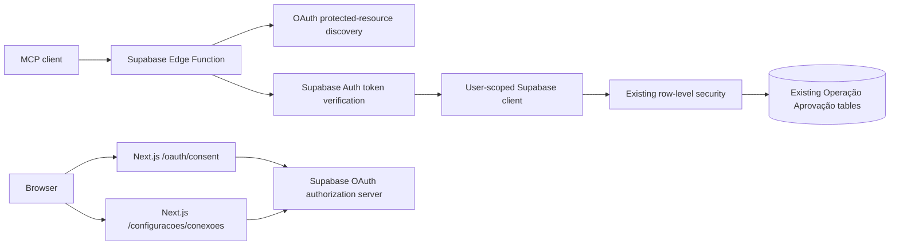

# Phase B: read-only MCP architecture

This phase adds the authenticated read-only MCP adapter without changing the product schema or the existing web data flows.

## Request flow

The function is deployed at `https://mnupjnlbsjsclxwlduon.supabase.co/functions/v1/operacao-aprovacao-mcp`. Production OAuth uses the Vercel consent route at `https://aprovacao-tau.vercel.app/oauth/consent`; Codex CLI OAuth and MCP tool discovery have been verified.

The function runs the official Supabase protected-resource middleware before user-token middleware. This order allows standards-based OAuth discovery while requiring valid Supabase user authentication for MCP operations. It never creates a service-role client. Every table query also includes the verified user's `user_id` in addition to existing RLS.

The MCP SDK creates a stateless server per HTTP request. `tools.ts` is the transport adapter and query layer. The domain layer remains the source of canonical aggregate rules: performance reads call `calculateAnalytics` from `src/features/analytics/domain/calculate-aggregates.ts`, including the existing rule that a question batch replacing session totals prevents double-counting.

## Change boundary

- No migration and no new table.
- No assistant write tools.
- No arbitrary SQL, generic table access, or user-supplied owner IDs.
- Results have explicit row/window/size bounds; the analytics tool rejects a truncated aggregate instead of returning misleading partial metrics.
- The OAuth consent view uses the signed-in Supabase session. Login return paths are allowlisted to the consent URL to avoid open redirects.
- The connected-apps page uses Supabase Auth's grant APIs, allowing each user to revoke OAuth access without changing study records.

## Local development config

`supabase/config.toml` configures the local Supabase stack, not the production dashboard. It deliberately uses `http://localhost:3000` as its local consent site. Production is configured separately in the Supabase dashboard with the Vercel site URL, `/oauth/consent`, OAuth server enabled, dynamic registration enabled, and ES256 signing. Avoid `supabase config push` unless every unrelated Auth setting in the local config has been reviewed for production impact.
